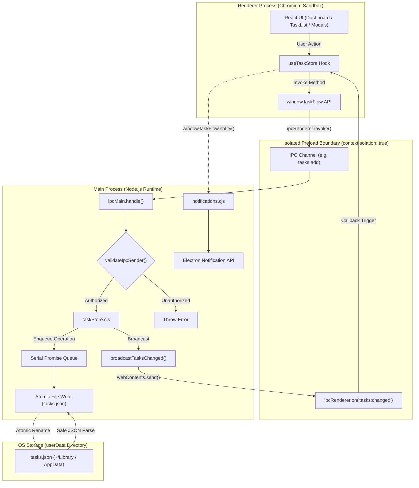

# TaskFlow Pro

A fast, secure, native desktop task management application built with **Electron**, **React**, and **Vite**.

TaskFlow Pro bridges modern React component architecture with native desktop capabilities, providing a distraction-free, privacy-first task workspace. All data is persisted locally in human-readable JSON within the operating system's application data directory, with zero remote telemetry, zero cloud latency, and complete offline capability.

---

## Table of Contents

- [Features](#features)
- [Technology Stack](#technology-stack)
- [Project Architecture](#project-architecture)
  - [Directory Structure](#directory-structure)
  - [Architectural Layers & Responsibilities](#architectural-layers--responsibilities)
  - [Architecture & Data Flow Diagram](#architecture--data-flow-diagram)
  - [Data Flow Mechanics](#data-flow-mechanics)
- [Prerequisites](#prerequisites)
- [Installation and Local Development](#installation-and-local-development)
  - [Available Scripts](#available-scripts)
- [Environment Configuration](#environment-configuration)
- [Application Usage Guide](#application-usage-guide)
- [Security Architecture](#security-architecture)
- [Data Storage and Recovery](#data-storage-and-recovery)
- [Testing and Quality Assurance](#testing-and-quality-assurance)
- [Troubleshooting Common Issues](#troubleshooting-common-issues)
- [Build and Distribution](#build-and-distribution)
- [License](#license)

---

## Features

### Implemented & Verified Features

- **Task Lifecycle Management (CRUD)**:
  - Create new tasks with title, description, priority, and due date.
  - View tasks in a responsive list sorted with the newest entries first.
  - In-place task editing via dedicated modal dialogs.
  - One-click task completion toggling with optimistic UI updates.
  - Permanent task deletion backed by a modal confirmation dialog.
- **Priorities & Scheduling**:
  - Three priority tiers: `Low`, `Medium`, and `High` with visual badge indicators.
  - Optional calendar due dates (`YYYY-MM-DD`) with human-friendly relative formatting (`Today`, `Tomorrow`, `Yesterday`, or formatted date string).
  - Visual overdue warnings for incomplete tasks past their deadline.
- **Dashboard Statistics & Progress Analytics**:
  - Live metric cards tracking **Total**, **Active**, and **Completed** tasks.
  - Reactive progress panel displaying total task completion percentage (`0%` to `100%`).
- **Dynamic Search & Filtering**:
  - Instant text search across both task titles and descriptions.
  - Status navigation filter: `All Tasks`, `Active Tasks`, and `Completed Tasks`.
  - Priority dropdown filter: `All Priorities`, `High`, `Medium`, and `Low`.
  - Filter reset shortcuts when search or filter combinations yield zero results.
- **In-Dashboard Modal Dialogs**:
  - Centered Add Task modal with dark backdrop overlay.
  - Keyboard accessibility: Dismiss modal via `Escape` key (guarded during active save).
  - Click-outside overlay dismissal.
- **Thread-Safe Local Persistence**:
  - JSON flat-file storage inside the OS `app.getPath('userData')` directory.
  - Atomic file writes using temporary file creation and atomic rename operations.
  - Serialized asynchronous queue to eliminate concurrent write race conditions.
  - Automatic recovery from corrupted JSON files with timestamped backup generation.
- **Native Operating System Notifications**:
  - Native desktop notification dispatched when a task is created (`TaskFlow Pro: Your task has been created successfully.`).
  - Native desktop notification dispatched when a task is marked complete (`TaskFlow Pro: Your task has been marked as completed.`).
  - Predefined notification templates preventing arbitrary renderer payload injection.
  - Clicking notification brings the application window to the foreground.
  - In-app toast banners provide visual fallback confirmation inside the renderer.
- **Application Menu & Native Shortcuts**:
  - Native OS Application Menu supporting macOS standard menus (About, Services, Hide, Quit).
  - Global menu action and accelerator `CmdOrCtrl+N` to open the Add Task modal.
  - View navigation controls: Reload (`CmdOrCtrl+R`), DevTools (`Alt+Cmd+I` / `Ctrl+Shift+I`), and Fullscreen (`Ctrl+Cmd+F` / `F11`).
- **Strict Desktop Security**:
  - Context isolation enabled (`contextIsolation: true`).
  - Node integration disabled (`nodeIntegration: false`).
  - OS-level Chromium process sandboxing enabled (`sandbox: true`).
  - IPC sender frame validation preventing unauthorized web origins from invoking backend handlers.
  - Hardened navigation locks preventing external URL redirects or rogue window spawns.

### Planned / Roadmap Features (Not Yet Implemented)

- [ ] Cloud synchronization and multi-device account linking.
- [ ] Multi-column Kanban board view.
- [ ] Custom user categories and tag management.
- [ ] Export task database to CSV or Markdown formats.

---

## Technology Stack

| Layer | Technology | Version | Purpose in TaskFlow Pro |
| :--- | :--- | :--- | :--- |
| **Desktop Runtime** | Electron | `^45.0.0` | Provides native windowing (`BrowserWindow`), application lifecycle (`app`), system menus (`Menu`), native notifications (`Notification`), and privileged file system access. |
| **User Interface** | React | `^19.3.1` | Declarative UI layer for state management, reactive filtering, progress calculation, and modular component hierarchy. Built strictly with JavaScript/JSX (no TypeScript). |
| **DOM Renderer** | React DOM | `^19.3.1` | Mounts and reconciles the React component tree into the Chromium renderer process. |
| **Build Tool & Dev Server** | Vite | `^8.3.5` | High-performance build tool offering instant Hot Module Replacement (HMR) in development and Rollup bundling in production. |
| **Electron Integration** | `vite-plugin-electron` | `^1.1.2` | Orchestrates the simultaneous compilation of Electron main/preload scripts and manages process lifecycle during development. |
| **Renderer Integration** | `vite-plugin-electron-renderer` | `^1.0.0` | Configures Vite's module resolution for Electron environments. |
| **Packaging & Distribution**| `electron-builder` | `^26.18.0` | Packages compiled assets and runtime binaries into ASAR archives and installers (`.dmg`, NSIS `.exe`, `.AppImage`, `.deb`). |
| **Security Bridge** | Electron `contextBridge` | Built-in | Safely exposes the `window.taskFlow` IPC API to the isolated renderer window. |
| **Persistence Engine** | Node.js `fs/promises` & `crypto` | Built-in | Manages atomic file operations, directory creation, serial execution queues, and UUID generation (`crypto.randomUUID()`). |
| **Styling** | Vanilla CSS | Standard | Modern dark-themed CSS design tokens (`src/styles/theme.css`) with zero third-party UI framework overhead. |
| **Test Runner** | Node.js Test Runner | Built-in | Automated unit and integration testing via `node:test` and `node:assert`. |

---

## Project Architecture

### Directory Structure

```
DesktopApp_Project/
├── build/                        # Distribution resources and icons
│   ├── icon.icns                 # Multi-resolution macOS icon bundle
│   └── icon.png                  # 512x512 PNG master icon (Windows & Linux)
├── electron/                     # Electron Main & Preload Process Source
│   ├── ipcHandlers.cjs           # Modular IPC registration & sender validation
│   ├── main.cjs                  # Main process lifecycle, window, & native menu
│   ├── notifications.cjs         # Native OS notification dispatcher & templates
│   ├── preload.cjs               # Context-isolated secure preload bridge
│   └── taskStore.cjs             # Local JSON file persistence engine & validation
├── src/                          # React 19 Frontend (Renderer Process)
│   ├── components/               # Modular UI Components
│   │   ├── AddTaskModal.jsx      # In-dashboard modal container for task creation
│   │   ├── ConfirmModal.jsx      # Confirmation dialog for permanent deletions
│   │   ├── Dashboard.jsx         # Central dashboard view controller
│   │   ├── DashboardHeader.jsx   # Header bar with title, counter, and Add Task button
│   │   ├── EmptyState.jsx        # Illustrated placeholder for empty task lists
│   │   ├── ErrorMessage.jsx      # Error banner with retry trigger
│   │   ├── FilterBar.jsx         # Filter toolbar wrapper
│   │   ├── Header.jsx            # Top navigation header
│   │   ├── ProgressPanel.jsx     # Completion percentage bar component
│   │   ├── Sidebar.jsx           # Filter navigation sidebar (All, Active, Completed)
│   │   ├── StatsCard.jsx         # Metric card component (Total, Active, Completed)
│   │   ├── SummaryCards.jsx      # Metric cards container grid
│   │   ├── TaskCard.jsx          # Individual task item card with actions
│   │   ├── TaskForm.jsx          # Controlled form for task creation and editing
│   │   ├── TaskList.jsx          # Scrollable task list container
│   │   └── TaskToolbar.jsx       # Search input, priority filter, & reset controls
│   ├── data/
│   │   └── mockTasks.js          # Reference schema definition for task records
│   ├── hooks/
│   │   └── useTaskStore.js       # Custom React hook connecting UI to window.taskFlow
│   ├── styles/                   # Modular CSS stylesheets
│   │   ├── AddTaskModal.css
│   │   ├── ConfirmModal.css
│   │   ├── Dashboard.css
│   │   ├── FilterBar.css
│   │   ├── Header.css
│   │   ├── index.css
│   │   ├── Sidebar.css
│   │   ├── SummaryCards.css
│   │   ├── TaskCard.css
│   │   ├── TaskForm.css
│   │   ├── TaskList.css
│   │   └── theme.css             # CSS variables & dark color palette
│   ├── utils/
│   │   ├── dateUtils.js          # Date formatting & overdue calculation helpers
│   │   └── filterUtils.js        # Search, filtering, and metric calculation helpers
│   ├── App.jsx                   # Root React component
│   └── main.jsx                  # React DOM entry point
├── test/                         # Automated Unit & Security Test Suite
│   ├── security.test.cjs         # IPC sender & notification security tests
│   └── taskStore.test.cjs        # Persistence, validation, & concurrency tests
├── index.html                    # Frontend HTML entry point
├── package.json                  # Project manifest, dependencies, & build config
├── vite.config.js                # Vite build configuration with Electron plugin
└── .gitignore                    # Git ignore definitions
```

---

### Architectural Layers & Responsibilities

1. **Main Process (`electron/main.cjs`)**:
   - Manages operating system interactions, process lifecycle, single-instance enforcement (`app.requestSingleInstanceLock()`), and `BrowserWindow` creation.
   - Builds the native OS menu and registers global keyboard shortcuts (`CmdOrCtrl+N`).
   - Hardens security by intercepting unauthorized navigation (`will-navigate`) and disallowing external child windows (`setWindowOpenHandler`).
2. **Preload Bridge (`electron/preload.cjs`)**:
   - Executes in an isolated context before the renderer loads.
   - Uses `contextBridge.exposeInMainWorld('taskFlow', ...)` to expose a strictly whitelisted asynchronous API (`listTasks`, `addTask`, `updateTask`, `toggleTask`, `deleteTask`, `notify`, `onTasksChanged`).
   - Does **not** expose `ipcRenderer`, Node `process`, `require`, or file system APIs to the DOM.
3. **IPC Controllers (`electron/ipcHandlers.cjs`)**:
   - Registers handlers via `ipcMain.handle`.
   - Validates IPC caller identity with `validateIpcSender()`, verifying that the caller belongs to a non-destroyed `BrowserWindow` loading from an approved origin.
   - Dispatches change broadcasts (`tasks:changed`) to synchronize UI windows upon mutations.
4. **Persistence Layer (`electron/taskStore.cjs`)**:
   - Manages asynchronous disk I/O to `tasks.json` inside `app.getPath('userData')`.
   - Protects against concurrency races using a serial execution queue.
   - Writes to a temporary file (`tasks.tmp.<timestamp>.<rand>`) with restricted permissions (`0o600`) before atomically renaming to `tasks.json`.
   - Defensively validates inputs against prototype pollution, illegal characters, and invalid dates.
5. **Renderer Process (`src/`)**:
   - Pure React 19 single-page application.
   - Interacts with the backend solely through `window.taskFlow` via the `useTaskStore` hook.
   - Manages UI state, optimistic updates, search/filter criteria, and in-app feedback toasts.

---

### Architecture & Data Flow Diagram



---

### Data Flow Mechanics

#### 1. Creating a Task
1. User clicks **+ Add Task** or presses `CmdOrCtrl+N`.
2. The React `AddTaskModal` opens, presenting the `TaskForm`.
3. User enters title, description, priority, and due date, then clicks **Create Task**.
4. `TaskForm` performs client validation and calls `createTask(payload)` from `useTaskStore`.
5. `useTaskStore` invokes `window.taskFlow.addTask(payload)`.
6. Preload routes the call through `ipcRenderer.invoke('tasks:add', payload)`.
7. `ipcHandlers.cjs` receives the call and verifies the sender with `validateIpcSender(event)`.
8. `taskStore.cjs` validates the payload (title length, control characters, valid calendar date) and enqueues the operation.
9. A unique UUID is generated via `crypto.randomUUID()`.
10. The task is written to `tasks.tmp.*` and atomically renamed to `tasks.json`.
11. `ipcHandlers.cjs` broadcasts `tasks:changed` to all open windows and returns the new task to the renderer.
12. The renderer updates React state, triggers an in-app toast, closes the modal, and sends a notification request to display the native OS banner.

#### 2. Reading Tasks on Application Startup
1. Main process creates the `BrowserWindow` loading `dist/index.html` (or `localhost:5173` in development).
2. React mounts `Dashboard` which invokes `useTaskStore`.
3. `useTaskStore` calls `window.taskFlow.listTasks()`.
4. `taskStore.cjs` reads `app.getPath('userData')/tasks.json`.
   - If the file is missing (`ENOENT`), it returns an empty array `[]`.
   - If corrupted (`SyntaxError`), it backs up the file to `tasks.corrupted-<timestamp>.json` and returns `[]`.
5. The parsed task array is returned to the React state and rendered in the dashboard.

---

## Prerequisites

Before setting up TaskFlow Pro, ensure your environment meets the following requirements:

- **Node.js**: `v18.0.0` or higher (tested on `v26.7.0`).
- **npm**: `v9.0.0` or higher (bundled with Node.js).
- **Git**: Installed and available in your shell `PATH`.
- **Operating System**:
  - **macOS**: macOS 11.0 (Big Sur) or higher (Apple Silicon `arm64` or Intel `x64`).
  - **Windows**: Windows 10 or 11 (`x64`).
  - **Linux**: Ubuntu 20.04+, Debian 11+, Fedora 36+, or Arch Linux (`x64`).

---

## Installation and Local Development

Follow these steps to set up and run TaskFlow Pro locally:

### 1. Clone the Repository
```bash
git clone https://github.com/your-username/DesktopApp_Project.git
cd DesktopApp_Project
```

### 2. Install Dependencies
```bash
npm install
```

### 3. macOS Notification Setup (macOS Only)
On macOS development environments, the unsigned prebuilt Electron binary will have its desktop notifications suppressed by macOS Notification Center. Run the included ad-hoc signing script:
```bash
npm run sign:dev
```

### 4. Start the Application in Development Mode
```bash
npm run dev
```
*This command starts the Vite development server with Hot Module Replacement and automatically launches the Electron desktop application.*

---

### Available Scripts

Every script listed below is defined in [package.json](file:///Users/vedanshsaini/Documents/sem 3/AppDevelopment/DesktopApp_Project/package.json):

| Command | Action | Description |
| :--- | :--- | :--- |
| `npm run dev` | `vite` | Starts Vite HMR dev server and launches Electron with live code reloading. |
| `npm run build` | `vite build` | Compiles the React frontend into `dist/` and compiles Electron main/preload scripts into `dist-electron/`. |
| `npm start` | `electron .` | Launches the prebuilt Electron binary using the compiled code in `dist-electron/`. |
| `npm run preview` | `vite preview` | Previews the compiled frontend bundle via Vite's static preview server. |
| `npm test` | `node --test test/*.test.cjs` | Runs the automated unit and security test suite using Node's built-in test runner. |
| `npm run sign:dev` | Ad-hoc codesign command | Ad-hoc signs the local `Electron.app` binary on macOS to enable native notifications. |
| `npm run package` | `npm run build && electron-builder --dir` | Builds production assets and packages an unpackaged application folder into `release/`. |
| `npm run dist` | `npm run build && electron-builder` | Builds production assets and creates the native installer for the current host OS. |
| `npm run dist:mac` | `npm run build && electron-builder --mac` | Compiles macOS application bundle (`.app`) and Apple Disk Image (`.dmg`). |
| `npm run dist:win` | `npm run build && electron-builder --win` | Compiles Windows NSIS installer and portable `.exe`. |
| `npm run dist:linux` | `npm run build && electron-builder --linux` | Compiles Linux `.AppImage` and `.deb` distribution packages. |

---

## Environment Configuration

TaskFlow Pro is designed as a **zero-configuration** application:

- **No `.env` file required**: The application does not require any environment variable files to build or run.
- **Dynamic Port Injection**: During development, `vite-plugin-electron` automatically detects Vite's port (default `5173`) and injects `process.env.VITE_DEV_SERVER_URL` into the main process.
- **Production Asset Isolation**: In production, `app.isPackaged` evaluates to `true`, causing Electron to ignore any environment variables and load static files directly from `dist/index.html`.
- **Security Notice**: Never hardcode API keys, passwords, or personal credentials into repository files.

---

## Application Usage Guide

### 1. Launching the Application
Execute `npm run dev` in your terminal. The dashboard will launch with a sleek dark interface displaying your task metrics and active task list.

### 2. Creating a Task
- Click the blue **+ Add Task** button in the dashboard header, or press **`Cmd+N`** (macOS) / **`Ctrl+N`** (Windows/Linux).
- The **Create New Task** modal dialog will appear centered over the dashboard.
- Enter a **Task Title** (required, maximum 200 characters).
- Enter an optional **Description** (maximum 2000 characters).
- Select a **Priority** tier: `Low`, `Medium`, or `High`.
- Choose an optional **Due Date** using the calendar picker (`YYYY-MM-DD`).
- Click **Create Task**.
- The task is immediately persisted, an in-app confirmation toast appears, and a native OS desktop notification is displayed.

### 3. Filtering & Searching Tasks
- **By Status**: Click on `All Tasks`, `Active Tasks`, or `Completed Tasks` in the left sidebar to filter the view.
- **By Priority**: Select `High`, `Medium`, or `Low` from the priority dropdown in the toolbar.
- **By Search Text**: Type any keyword into the search bar. The list filters instantly against both task titles and task descriptions.
- **Resetting Filters**: Click **Reset filters** to restore the default view.

### 4. Completing and Editing Tasks
- **Mark Complete**: Click the circular checkbox on any task card. The task transitions to completed, your dashboard metrics update, and a completion notification appears.
- **Edit Task**: Click the pencil icon on any task card to open the edit dialog, update your task details, and click **Save Changes**.

### 5. Deleting a Task
- Click the trash icon on any task card.
- A confirmation dialog will prompt: *"Are you sure you want to permanently delete this task?"*
- Click **Delete Task** to remove the record permanently from disk.

### 6. Application Menu & Shortcuts
- `CmdOrCtrl + N`: Open Add Task modal.
- `CmdOrCtrl + R`: Reload application.
- `CmdOrCtrl + Shift + R`: Force reload application.
- `Alt + Cmd + I` (macOS) / `Ctrl + Shift + I` (Windows/Linux): Toggle Chromium Developer Tools.
- `Ctrl + Cmd + F` (macOS) / `F11` (Windows/Linux): Toggle Fullscreen.
- `CmdOrCtrl + Q`: Quit TaskFlow Pro.

---

## Security Architecture

TaskFlow Pro adheres strictly to Electron's official security best practices:

```
┌─────────────────────────────────────────────────────────────┐
│                      Renderer Process                       │
│  - contextIsolation: true                                   │
│  - nodeIntegration: false                                   │
│  - sandbox: true                                            │
│  - No access to require(), process, Buffer, or fs           │
└──────────────────────────────┬──────────────────────────────┘
                               │
                window.taskFlow API Bridge
                               │
┌──────────────────────────────▼──────────────────────────────┐
│                    Preload Script Context                   │
│  - Exposes only whitelisted functions via contextBridge     │
│  - Strips Electron internal event objects from callbacks    │
│  - Hardcoded IPC channel strings                            │
└──────────────────────────────┬──────────────────────────────┘
                               │
                      ipcRenderer.invoke()
                               │
┌──────────────────────────────▼──────────────────────────────┐
│                     Main Process Security                   │
│  - validateIpcSender() checks window destruction and origin │
│  - Strict input sanitization in taskStore.cjs               │
│  - will-navigate intercepts unauthorized redirects          │
│  - setWindowOpenHandler blocks external popups              │
└─────────────────────────────────────────────────────────────┘
```

1. **Context Isolation (`contextIsolation: true`)**:
   Ensures that both the preload script and the Electron internal logic run in an isolated execution context separate from the website's `window` object, preventing prototype pollution attacks.
2. **Node Integration Disabled (`nodeIntegration: false`)**:
   Prevents client-side scripts from accessing Node.js runtime primitives (`require`, `process`, `fs`).
3. **OS-Level Process Sandbox (`sandbox: true`)**:
   Runs Chromium renderers inside an operating system-level sandbox, severely restricting file-system and hardware access.
4. **Preload Security via `contextBridge`**:
   The preload script does not pass `ipcRenderer` to the window. Instead, it exposes explicit async methods (`addTask`, `listTasks`, etc.) with fixed channel names.
5. **IPC Sender Origin Validation (`validateIpcSender`)**:
   Every IPC handler checks `event.sender`. Requests from destroyed windows or unrecognized origins are rejected immediately.
6. **Navigation Lockdown**:
   - `webContents.on('will-navigate')`: Blocks unexpected window navigations.
   - `webContents.setWindowOpenHandler()`: Returns `{ action: 'deny' }` for any attempts to open unmanaged windows via `window.open` or `<a target="_blank">`.
7. **Main Process Input Sanitization**:
   Input validation is enforced in the main process before disk operations. Titles are checked for illegal control characters (`[\u0000-\u001F\u007F]`), descriptions for null bytes, and object keys for prototype pollution attempts (`__proto__`, `constructor`, `prototype`).

---

## Data Storage and Recovery

### Storage Directory by Platform

Task data is stored in a clean, human-readable JSON format at `tasks.json` within the standard OS user-data directory:

- **macOS**: `~/Library/Application Support/TaskFlow Pro/tasks.json`
- **Windows**: `%APPDATA%\TaskFlow Pro\tasks.json`
- **Linux**: `~/.config/TaskFlow Pro/tasks.json`
- **Headless / Test Fallback**: `.taskflow_data/tasks.json`

### Storage Schema Example

```json
[
  {
    "id": "c8a412b1-5df7-4972-9fa6-1e9a4cb3e0a1",
    "title": "Finalize College Presentation",
    "description": "Prepare slides and verify production build on macOS.",
    "priority": "high",
    "status": "todo",
    "completed": false,
    "dueDate": "2026-10-30",
    "createdAt": "2026-10-25T10:00:00.000Z",
    "updatedAt": "2026-10-25T10:00:00.000Z"
  }
]
```

### Persistence and Concurrency Guarantees

- **Atomic Writes**: Data is serialized and written to a temporary file (`tasks.tmp.<timestamp>.<rand>`) with user-only permissions (`0o600`). The file is then atomically renamed over `tasks.json`. If a write fails or power is interrupted mid-write, the existing `tasks.json` remains uncorrupted.
- **Serialized Operations**: All read, update, and write tasks are funneled through an asynchronous promise queue (`enqueue()`). Rapid consecutive UI actions execute sequentially, avoiding lost updates.
- **Corrupted Data Recovery**: If `tasks.json` is modified externally with invalid JSON syntax, `taskStore.cjs` catches the `SyntaxError`, renames the invalid file to `tasks.corrupted-<timestamp>.json` so that user data is preserved for manual recovery, and initializes a clean task list.
- **Manual Backup**: Users can back up their tasks at any time by copying `tasks.json` from their platform application support directory.

---

## Testing and Quality Assurance

TaskFlow Pro includes a comprehensive automated test suite built on the native Node.js test runner (`node:test`).

### Running the Test Suite

```bash
npm test
```

### Verified Test Suite Summary (9/9 Tests Passing)

#### Security & Diagnostics (`test/security.test.cjs`)
- **TC-AUTO-07**: Validates and rejects unauthorized or malformed IPC senders.
- **TC-AUTO-08**: Enforces predefined safe notification templates strictly.
- **TC-AUTO-09**: Handles unsupported notification environments gracefully without crashing.

#### Persistence Engine & Concurrency (`test/taskStore.test.cjs`)
- **TC-AUTO-01**: Creates tasks with default priority and valid ISO timestamps.
- **TC-AUTO-02**: Rejects empty or whitespace-only task titles.
- **TC-AUTO-03**: Rejects invalid calendar due dates (e.g., `2026-02-31`) and out-of-range years.
- **TC-AUTO-04**: Rejects malformed task IDs and prototype pollution keys.
- **TC-AUTO-05**: Handles rapid concurrent mutations atomically without losing records.
- **TC-AUTO-06**: Recovers cleanly from malformed/corrupted `tasks.json` files by generating backup archives.

---

## Troubleshooting Common Issues

| Issue / Error | Root Cause | Solution |
| :--- | :--- | :--- |
| **`__dirname is not defined`** | Project root uses ES Modules (`"type": "module"` in `package.json`), where `__dirname` is unavailable. | In ES module files (like `vite.config.js`), use `fileURLToPath(import.meta.url)` to derive `__dirname`. CommonJS files in `electron/` must retain the `.cjs` extension. |
| **Preload script failed to load** | Stale preload path or mismatch between development and packaged ASAR archive locations. | Verify `electron/main.cjs` uses `resolvePreloadPath()`. In production, preload is located alongside `main.cjs` inside `dist-electron/preload.cjs`. |
| **Notifications do not appear on macOS** | Development builds use the unsealed Electron binary identifier (`com.github.Electron`), which macOS Notification Center silences. | Run `npm run sign:dev` to apply an ad-hoc code signature to the local binary, and check macOS **System Settings > Notifications > Electron**. |
| **`Electron failed to install correctly`** | Prebuilt binary download was interrupted or blocked by network restrictions during `npm install`. | Run `node node_modules/electron/install.js` to re-download the prebuilt platform binary. |
| **Corrupted `tasks.json` detected** | Malformed JSON syntax in `tasks.json` from external editing. | Check your application user-data directory for `tasks.corrupted-<timestamp>.json`. Inspect the backup file and repair any malformed syntax. |
| **Packaged app displays blank white screen** | Static assets loaded with absolute paths (`/assets/`) instead of relative paths (`./assets/`). | Ensure `base: './'` is configured in `vite.config.js` so all scripts and styles resolve correctly relative to `index.html`. |

---

## Build and Distribution

TaskFlow Pro is configured with `electron-builder` to produce standalone native desktop executables and installers.

### 1. Generating an Unpacked Application Directory
To test packaging without compiling full disk images:
```bash
npm run package
```
*Outputs an executable bundle into `release/mac-arm64/TaskFlow Pro.app` (on Apple Silicon macOS).*

### 2. Generating Native Installers

#### macOS (Apple Silicon & Intel)
```bash
npm run dist:mac
```
- Produces: `release/TaskFlow Pro-1.0.0-arm64.dmg` and standalone `.app` bundle.
- Includes: Application icons (`build/icon.icns`), dark theme presentation, and drag-and-drop Applications folder symlink.

#### Windows (10 & 11)
```bash
npm run dist:win
```
- Produces: `release/TaskFlow Pro Setup 1.0.0.exe` (NSIS installer) and portable `.exe`.
- Features: Custom installation directory selection, Start Menu shortcuts, Desktop shortcuts, and uninstaller.

#### Linux
```bash
npm run dist:linux
```
- Produces: `release/TaskFlow Pro-1.0.0.AppImage` and `release/TaskFlow Pro-1.0.0.deb`.

---

### Code Signing and Notarization

When distributing to external users outside of local testing:

- **macOS Gatekeeper**: macOS blocks unnotarized applications downloaded from the internet. To distribute publicly, sign the app using an **Apple Developer ID Application Certificate** and notarize it via Apple Notary Service:
  ```bash
  xcrun notarytool submit "release/TaskFlow Pro-1.0.0-arm64.dmg" --apple-id "developer@email.com" --team-id "TEAM_ID" --password "app-specific-pwd" --wait
  xcrun stapler staple "release/TaskFlow Pro-1.0.0-arm64.dmg"
  ```
  *(For local peer-to-peer distribution without a developer certificate, users can bypass Gatekeeper quarantine by running: `xattr -cr "/Applications/TaskFlow Pro.app"`).*
- **Windows SmartScreen**: Windows displays a SmartScreen warning for unrecognised binaries. Sign the executable with a valid **Microsoft Authenticode Certificate** (EV or standard) to establish instant reputation.

---

## License

This project is licensed under the [MIT License](file:///Users/vedanshsaini/Documents/sem 3/AppDevelopment/DesktopApp_Project/package.json).
